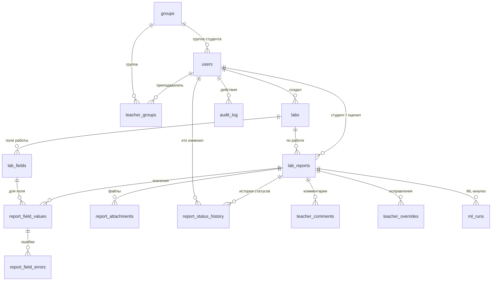

# Описание базы данных

База хранит пользователей, лабораторные работы, отчёты студентов и проверку этих отчётов преподавателями.
Всего 14 таблиц. Поле `id` во всех таблицах — уникальный номер записи.

## Схема связей

`A ||--o{ B` — одна запись из A связана со многими записями из B.

Главная таблица — `lab_reports`: почти все остальные данные об отчёте привязаны к ней.

## Таблицы

### users — пользователи
Студенты, преподаватели, администраторы.

| Поле | Описание |
|---|---|
| `role` | Роль пользователя |
| `login`, `password_hash` | Логин и зашифрованный пароль |
| `last_name`, `first_name`, `middle_name` | ФИО |
| `group_id` | Группа студента → `groups` |
| `selectable_for_students` | Показывать ли пользователя студентам в списках |
| `status` | Состояние учётной записи |
| `created_at`, `updated_at` | Дата создания и изменения |

### groups — учебные группы

| Поле | Описание |
|---|---|
| `name` | Название группы |
| `created_at` | Дата создания |

### teacher_groups — кто из преподавателей какие группы ведёт
Связь «многие ко многим».

| Поле | Описание |
|---|---|
| `teacher_id` | Преподаватель → `users` |
| `group_id` | Группа → `groups` |

### labs — лабораторные работы

| Поле | Описание |
|---|---|
| `title`, `description` | Название и описание |
| `is_published` | Опубликована ли работа (видна студентам) |
| `created_by` | Автор → `users` |
| `created_at`, `updated_at` | Дата создания и изменения |

### lab_fields — поля бланка лабораторной
Что студент должен заполнить в работе.

| Поле | Описание |
|---|---|
| `lab_id` | Работа → `labs` |
| `field_key` | Служебное имя поля |
| `label` | Подпись поля для студента |
| `field_type` | Тип данных |
| `position` | Порядок отображения |
| `required` | Обязательно ли заполнять |

### lab_reports — отчёты студентов
Один отчёт — одна работа, выполненная одним студентом.

| Поле | Описание |
|---|---|
| `student_id` | Студент → `users` |
| `lab_id` | Работа → `labs` |
| `status` | Текущее состояние отчёта |
| `grade` | Оценка |
| `graded_by` | Кто поставил оценку → `users` |
| `created_at`, `updated_at` | Дата создания и изменения |

### report_field_values — значения в отчёте
Что студент ввёл в каждое поле.

| Поле | Описание |
|---|---|
| `report_id` | Отчёт → `lab_reports` |
| `field_id` | Поле → `lab_fields` |
| `value` | Введённое значение |
| `updated_at` | Дата изменения |

### report_field_errors — ошибки в значениях
Результаты проверки введённых данных.

| Поле | Описание |
|---|---|
| `value_id` | Значение → `report_field_values` |
| `error_type` | Тип ошибки |
| `message` | Текст ошибки |
| `created_at` | Дата фиксации |

### report_attachments — файлы к отчёту

| Поле | Описание |
|---|---|
| `report_id` | Отчёт → `lab_reports` |
| `file_name`, `file_path` | Имя файла и место хранения |
| `mime_type`, `size_bytes` | Тип и размер файла |
| `created_at` | Дата загрузки |

### report_status_history — история статусов отчёта

| Поле | Описание |
|---|---|
| `report_id` | Отчёт → `lab_reports` |
| `status` | Установленный статус |
| `changed_by` | Кто изменил → `users` |
| `comment` | Комментарий к смене |
| `changed_at` | Дата изменения |

### teacher_comments — комментарии преподавателя

| Поле | Описание |
|---|---|
| `report_id` | Отчёт → `lab_reports` |
| `field_id` | Поле → `lab_fields` |
| `teacher_id` | Автор → `users` |
| `text` | Текст комментария |
| `created_at` | Дата |

### teacher_overrides — исправления преподавателя
Фиксирует, что было, что стало и почему.

| Поле | Описание |
|---|---|
| `report_id` | Отчёт → `lab_reports` |
| `field_id` | Поле → `lab_fields` |
| `teacher_id` | Кто исправил → `users` |
| `override_type` | Вид исправления |
| `old_value`, `new_value` | Значение до и после |
| `reason` | Причина |
| `created_at` | Дата |

### ml_runs — запуски ML-анализа

| Поле | Описание |
|---|---|
| `report_id` | Отчёт → `lab_reports` |
| `model_name` | Название модели |
| `status` | Состояние запуска |
| `result_json` | Результат (JSON) |
| `started_at`, `finished_at` | Начало и конец запуска |

### audit_log — журнал действий
Кто, что и когда сделал в системе.

| Поле | Описание |
|---|---|
| `actor_id` | Кто совершил действие → `users` |
| `action` | Действие |
| `entity`, `entity_id` | Таблица и номер записи, к которым относится действие |
| `payload_json` | Подробности (JSON) |
| `created_at` | Дата |
